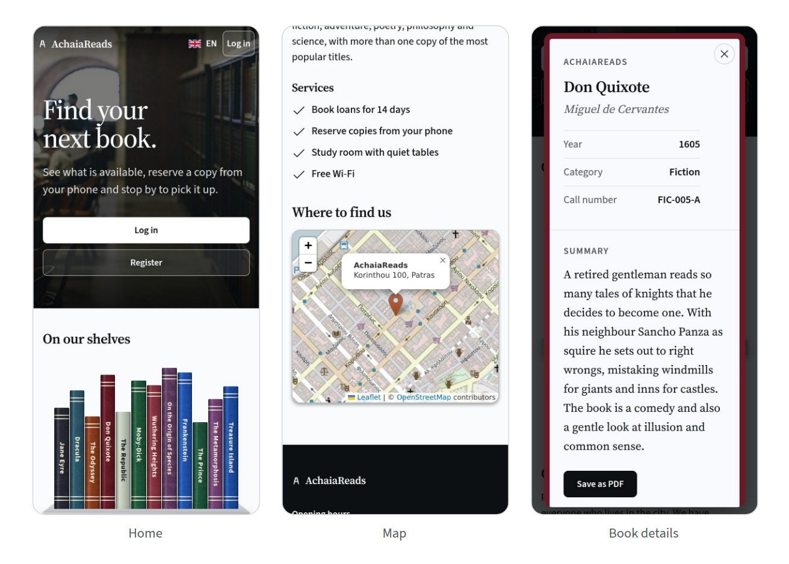
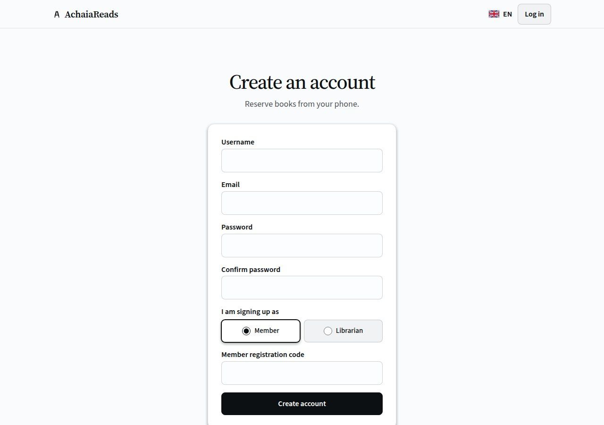
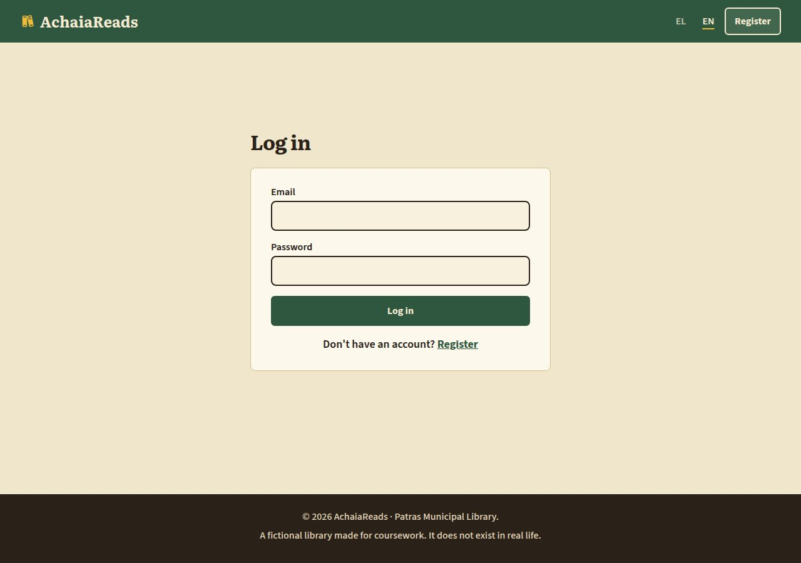
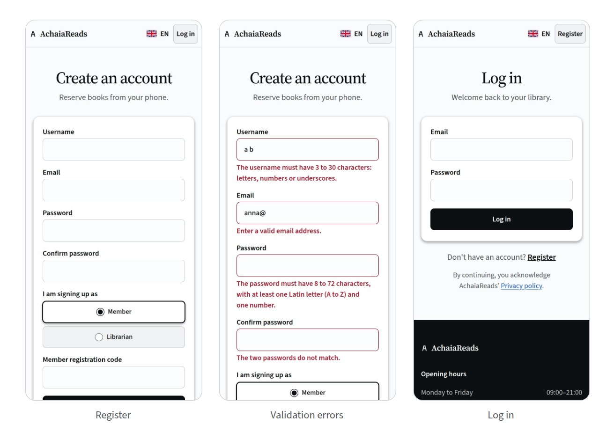
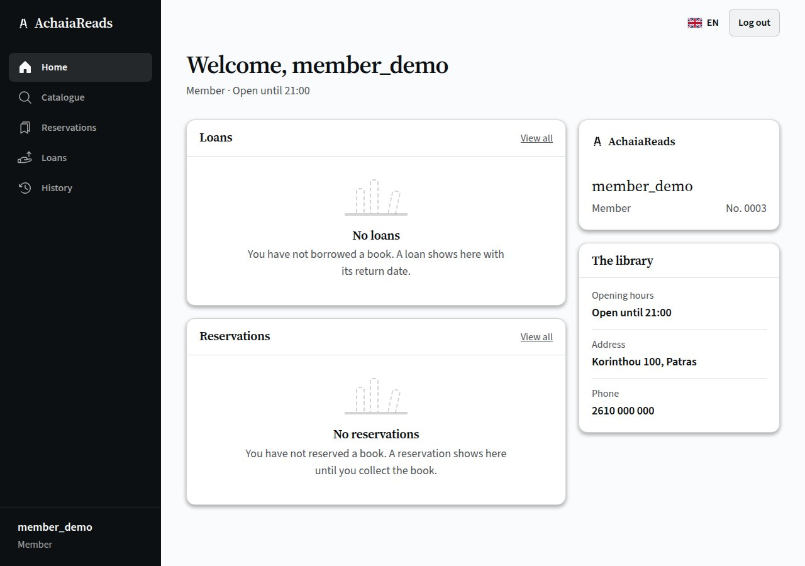
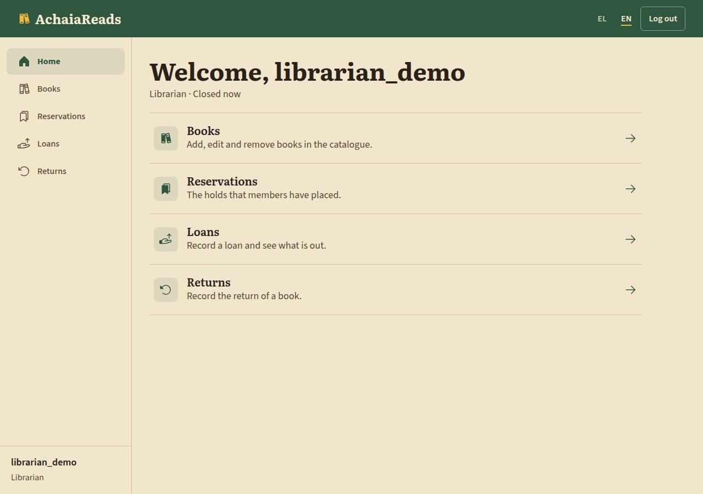
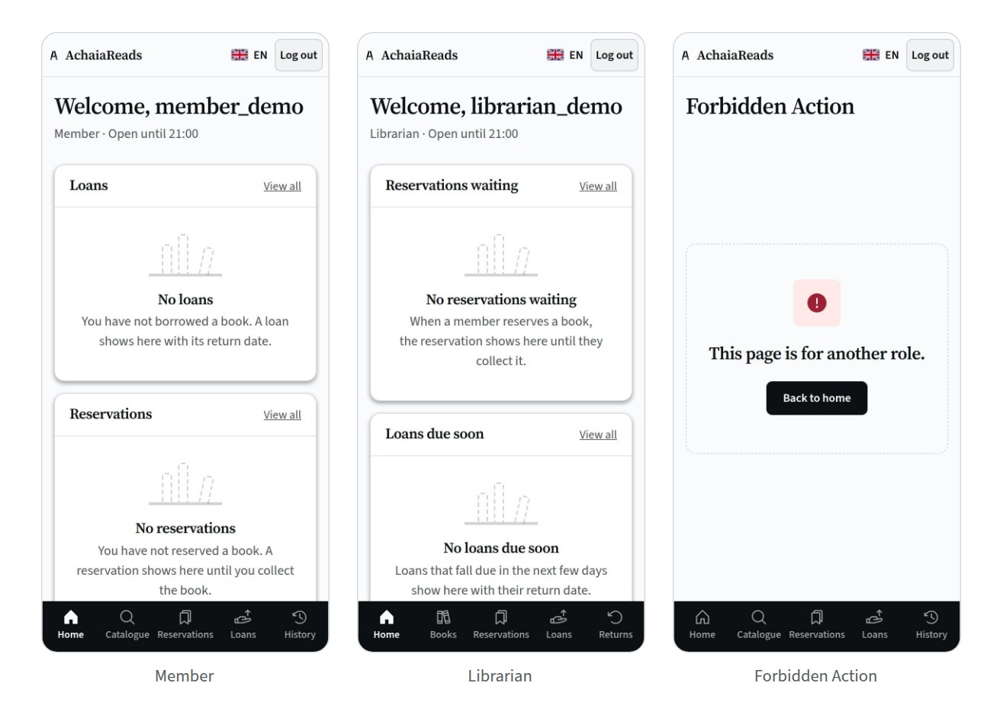
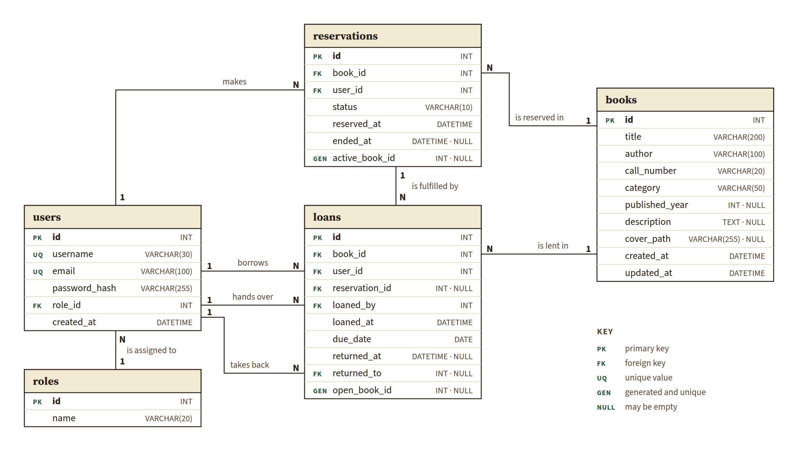

# Lectern

Lectern is the web application of AchaiaReads, a fictional municipal library in Patras. Visitors can browse the shelf, read the opening hours and find the library on a map. Members and librarians register with a code, log in, and see a dashboard with their own menu.

This repository holds **Part A** of the CN5006 Web and Mobile Application Development coursework at the University of East London, 2026-27. Part A covers the public page, registration, login, the database and a dashboard that checks the role. The catalogue, reservation, loan and return pages are placeholders until Part B.

| | |
|---|---|
| Server | PHP, no framework (tested on 8.5) |
| Database | MySQL or MariaDB |
| Client | HTML, CSS and JavaScript, no build step |
| Map | Leaflet with OpenStreetMap tiles |
| Languages | Greek and English, switched with the language link in the header |

## Screens

### Public page

The home page shows the shelf of books, the opening hours, the contact details and a map with the library marked. A click on a book opens its details. The page works on a phone first and grows to a desktop layout.

### Registration and login

| Registration | Login |
|---|---|
|  |  |

### Dashboard

After login, every user lands on the same dashboard page, and the menu depends on the role.

| Member | Librarian |
|---|---|
|  |  |

## How it works

### Registration

1. The visitor enters a username, an email, a password, the password again, a role and the registration code of that role.
2. JavaScript checks the fields when the form is sent (`js/validate.js`). Once a field is wrong, it is checked again while the visitor fixes it.
3. PHP checks the same rules again on the server (`classes/Validator.php`), because the browser checks can be skipped.
4. The code must belong to the role that was chosen, so nobody can register as a librarian without the librarian code. The role id that is saved is set by the server after this check, not copied from the form.
5. The password is stored only as a hash made by `password_hash`. The email and the username must be new.

| Field | Rule |
|---|---|
| Username | 3 to 30 characters, letters, numbers and underscores |
| Email | A valid address, at most 100 characters |
| Password | 8 to 72 characters, with at least one letter and one number |
| Confirmation | The same as the password |
| Role | Member or librarian |
| Code | The registration code of the chosen role |

### Login and sessions

1. The visitor enters an email and a password. Both are validated.
2. `password_verify` compares the password with the stored hash. A wrong email and a wrong password give the same message, so the form does not tell which one was wrong.
3. After a successful login the session gets a new id (`session_regenerate_id`) and holds the user id, the username and the role id.
4. Logout destroys the session and returns to the public page.

### Roles and access control

The roles are stored in the database. Every page that needs a login starts with a guard from `includes/auth.php`.

| Who opens | What happens |
|---|---|
| A visitor who is not logged in, opening a dashboard page | Sent to the login page |
| A logged in user, opening a page of their own role | The page opens |
| A logged in user, opening a page of the other role | The **Forbidden Action** page, with HTTP status 403 |
| A logged in user, opening the login or registration page | Sent to the dashboard |

| Role | Menu |
|---|---|
| Member | Home, Catalogue, Reservations, Loans, History |
| Librarian | Home, Books, Reservations, Loans, Returns |

## Database

The database is called `lectern` and has five tables. The full description and the import steps are in [`notes/database.md`](notes/database.md).

| Table | What it holds |
|---|---|
| `roles` | The two roles, member and librarian |
| `users` | Every account, with a hashed password and a role |
| `books` | One row per physical copy, so two copies of a title are two rows |
| `reservations` | A member asking for a copy, with a status |
| `loans` | A copy handed to a member, open until it is returned |

A copy can be reserved only when it has no active reservation and no open loan. The database enforces this itself and PHP does not have to. Two unique keys allow one active reservation and one open loan per copy, a check limits the status of a reservation, and a trigger refuses a new active reservation on a copy that is on loan. The state of a copy is never stored in `books`, it is worked out from the other two tables, so it cannot get out of date. The sample data has 31 copies of 27 titles in five categories.

## Setup

Requires XAMPP with Apache and MySQL running.

1. Copy the `prototype` folder into `htdocs`.
2. In phpMyAdmin, import `prototype/database/schema.sql` and then `prototype/database/seed.sql`. The schema replaces any existing database named `lectern`.
3. Open `http://localhost/prototype/`.

The database login is set in `prototype/config.php` and defaults to the XAMPP values (`root`, no password).

### Accounts and codes

The sample data has two accounts. New accounts need the registration code of their role.

| Role | Email | Password | Registration code |
|---|---|---|---|
| Member | `member@lectern.test` | `member` | `MEMB2026` |
| Librarian | `librarian@lectern.test` | `librarian` | `LIBR2026` |

## Credits

Pictures, fonts, icons and libraries are credited in [`notes/credits.md`](notes/credits.md). The library itself is fictional.
