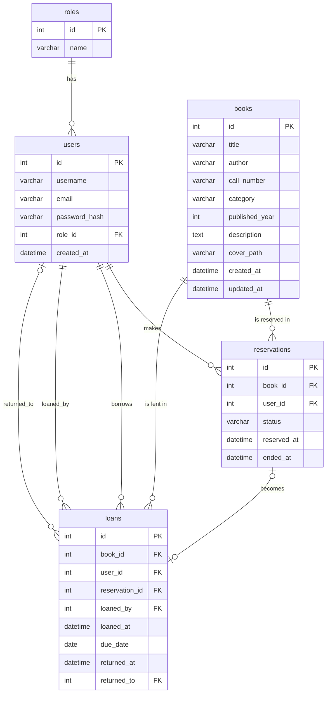

# Database notes

The database is called `lectern`. It works on MySQL and MariaDB and was tested on MariaDB 10.11 (the one that comes with XAMPP).

## Import

Two files are in `prototype/database/`. Import them in this order:

1. `schema.sql` creates the database and the five tables. It deletes an older `lectern` database first.
2. `seed.sql` adds the roles, two demo accounts, 31 book copies and a few sample reservations and loans.

In phpMyAdmin, open the **Import** tab from the server home page, choose the file and press **Import**. Do this for `schema.sql` and then for `seed.sql`.

From a terminal:

```
mysql -u root < prototype/database/schema.sql
mysql -u root < prototype/database/seed.sql
```

## Demo accounts

| Role | Email | Password |
|---|---|---|
| Member | `member@lectern.test` | `Demo-Member-2026` |
| Librarian | `librarian@lectern.test` | `Demo-Librarian-2026` |

## Tables

| Table | What it holds |
|---|---|
| `roles` | The two roles. Id 1 is member and id 2 is librarian. |
| `users` | Every account, with a hashed password and a `role_id`. |
| `books` | One row per physical copy. Two copies of a title are two rows. |
| `reservations` | A member asking for a copy. Status is `active`, `cancelled` or `fulfilled`. |
| `loans` | A copy handed to a member. It is open until `returned_at` is filled in. |

A copy is available when it has no active reservation and no open loan. The code checks this with a query before it accepts a new reservation. Availability is not stored in `books`, so it cannot get out of date.

## ER diagram


