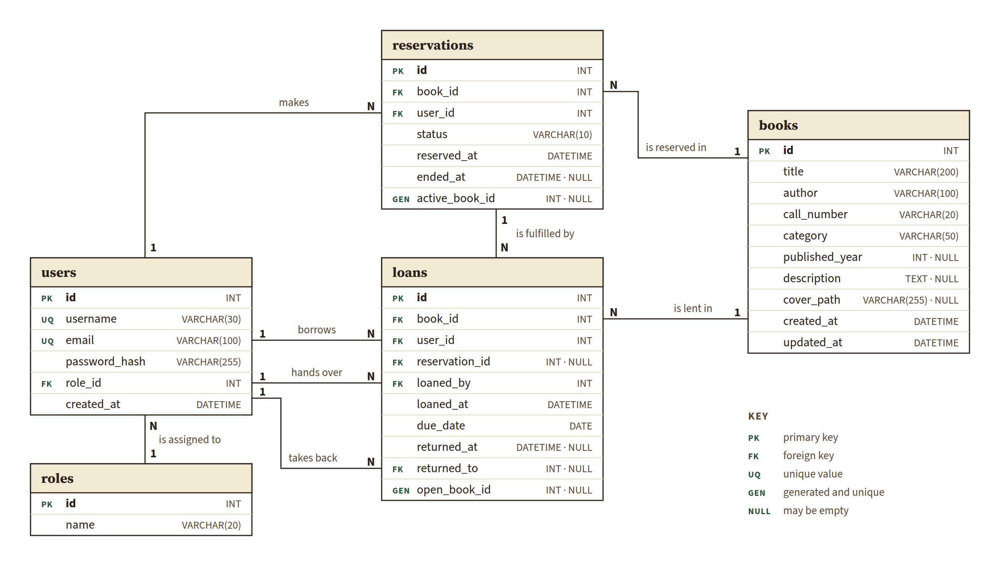

# Database notes

The database is called `lectern`. It works on MySQL and MariaDB and was tested on MariaDB 10.11 (the one that comes with XAMPP).

## Import

Two files are in `prototype/database/`. Import them in this order:

1. `schema.sql` creates the database, the five tables and the two roles. It deletes an older `lectern` database first. It is enough on its own to register new accounts.
2. `seed.sql` adds two demo accounts, 31 book copies and a few sample reservations and loans.

In phpMyAdmin, open the **Import** tab from the server home page, choose the file and press **Import**. Do this for `schema.sql` and then for `seed.sql`.

From a terminal:

```
mysql -u root < prototype/database/schema.sql
mysql -u root < prototype/database/seed.sql
```

## Demo accounts

| Role | Email | Password |
|---|---|---|
| Member | `member@lectern.test` | `member` |
| Librarian | `librarian@lectern.test` | `librarian` |

## Tables

| Table | What it holds |
|---|---|
| `roles` | The two roles. Id 1 is member and id 2 is librarian. |
| `users` | Every account, with a hashed password and a `role_id`. Username and email are unique. |
| `books` | One row per physical copy. Two copies of a title are two rows. |
| `reservations` | A member asking for a copy. Status is `active`, `cancelled` or `fulfilled`. |
| `loans` | A copy handed to a member. It is open until `returned_at` is filled in. |

A copy is available when it has no active reservation and no open loan. Availability is not stored in `books`, so it cannot get out of date. Part B finds it with a query.

## The single copy rule

The database refuses a second claim on a copy, even if two requests arrive at the same time or the PHP code has a mistake.

| Rule | How the database enforces it |
|---|---|
| One active reservation per copy | `reservations.active_book_id` holds the book id while the status is `active` and `NULL` after. A unique key on it refuses a second one. |
| One open loan per copy | `loans.open_book_id` holds the book id while `returned_at` is empty and `NULL` after. A unique key on it refuses a second one. |
| No new reservation on a loaned copy | The trigger `no_reservation_on_loan` stops a new active reservation when the copy has an open loan. A plain constraint cannot look at another table. |
| Only valid statuses | A check on `reservations.status` allows `active`, `cancelled` and `fulfilled`. |

The two helper columns are generated by the database and are never written by PHP. The history stays in the tables, because cancelled and fulfilled reservations and returned loans have `NULL` in the helper column and can repeat. To turn a reservation into a loan, Part B sets the reservation to `fulfilled` and then inserts the loan in one transaction.

`schema.sql` changes the delimiter to create the trigger. The `mysql` command and phpMyAdmin both read this.

## ER diagram



The same diagram as a vector file is `er-diagram.svg`. Types are shown without `UNSIGNED`, and every id column is an unsigned `INT` in the schema. `loans` points to `users` in three columns, so there are three lines between them: `user_id` (who borrows), `loaned_by` (the librarian who handed the copy over) and `returned_to` (the librarian who took it back, empty while the loan is open). Each line leaves `loans` at the row of its column. The two helper columns of the single copy rule are marked `GEN`.
